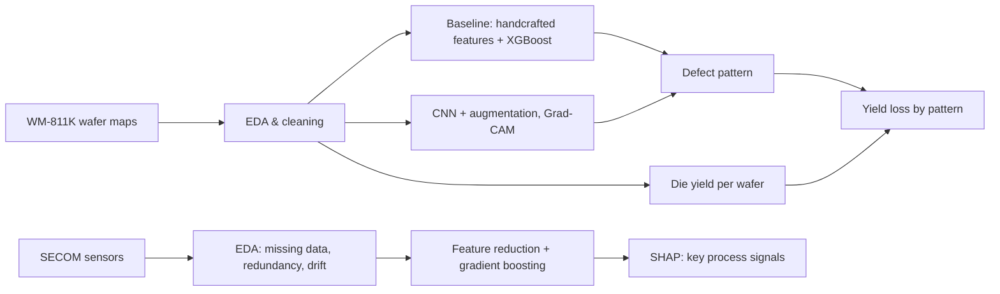

# Wafer Defect Classification & Yield Prediction


> **中文摘要：** 以公開半導體資料建立兩個模型：(1) 晶圓圖缺陷型態分類（WM-811K，CNN），
> (2) 由製程感測參數預測良品/不良（SECOM，梯度提升 + SHAP），並分析不同缺陷型態造成的良率損失。
> 重點放在不平衡資料處理、可解釋性，以及對製程工程師有用的結論。

## Why this project

In semiconductor manufacturing, every point of yield is money. Engineers need to know
**what kind of defect** is on a wafer (its spatial pattern points to the root-cause tool or
step) and **which process conditions** lead to failures. This project tackles both questions
with public fab data and asks how much yield each defect pattern costs.

## Datasets

| Dataset | What it contains | Task here |
|---|---|---|
| [WM-811K](https://www.kaggle.com/datasets/qingyi/wm811k-wafer-map) | 811,457 wafer maps (die pass/fail grid), ~172k labeled with 9 patterns | Classify defect pattern; compute per-wafer die yield |
| [SECOM](https://archive.ics.uci.edu/dataset/179/secom) | 1,567 production runs × 590 anonymised sensor readings, pass/fail label | Predict fail; find the process signals that drive it |

**Honest limitation:** the two datasets come from different fabs and share no wafer IDs, so
one wafer cannot be traced from its process readings to its defect pattern. The
"defect → yield" link is built *within* WM-811K, where each map records which dies failed.

## Pipeline



## Roadmap

- [x] **Step 1 — Data exploration & problem framing**: loaders, cleaning, EDA notebooks, tests, CI
- [ ] **Step 2 — Defect pattern classification** (WM-811K): baseline → CNN, imbalance handling, Grad-CAM
- [ ] **Step 3 — Process-based fail prediction** (SECOM): feature reduction, LightGBM/XGBoost, SHAP
- [ ] **Step 4 — Defect → yield analysis & demo**: yield loss per pattern, Streamlit app

## Results

_Filled in as each step is completed._

| Task | Model | Metric | Score |
|---|---|---|---|
| Defect pattern (9 classes) | — | Macro-F1 | — |
| Process fail prediction | — | PR-AUC | — |

**Why these metrics:** both datasets are heavily imbalanced (most wafers are `none`; ~7% of
SECOM runs fail), so accuracy would reward a model that always predicts the majority class.

## Repository structure

```
├── data/                 # raw/ and processed/ (git-ignored; see "Quick start")
├── notebooks/            # 01_eda_wm811k, 02_eda_secom, ...
├── reports/figures/      # charts used in this README
├── scripts/
│   ├── download_data.py  # fetches both datasets
│   └── make_notebooks.py # notebooks are generated from source for clean diffs
├── src/wafer/            # importable package: data loading, EDA, (models later)
├── tests/                # pytest on synthetic data, runs in CI without downloads
└── app/                  # Streamlit demo (step 4)
```

## Quick start

```bash
git clone https://github.com/join8112/wafer-yield-portfolio.git
cd wafer-yield-portfolio
python -m venv .venv && source .venv/bin/activate   # Windows: .venv\Scripts\activate
pip install -r requirements.txt && pip install -e .

# SECOM downloads directly. WM-811K needs a Kaggle token in ~/.kaggle/kaggle.json
python scripts/download_data.py

jupyter lab notebooks/
pytest
```

> `pandas` is pinned below 3.0 because `LSWMD.pkl` was saved with a very old pandas version
> that pandas 3 can no longer read.

CNN training (step 2) is designed to run on **Google Colab's free GPU**; everything else runs
on a laptop CPU.

## Skills demonstrated

- **Imbalanced classification**: metric choice, class weighting, augmentation
- **Computer vision**: CNN on wafer-map images, Grad-CAM interpretability
- **High-dimensional tabular ML**: missing data, redundant features, gradient boosting, SHAP
- **Domain reasoning**: connecting defect patterns and process signals to yield
- **Engineering**: installable package, tests on synthetic data, CI, reproducible setup

## License

MIT
