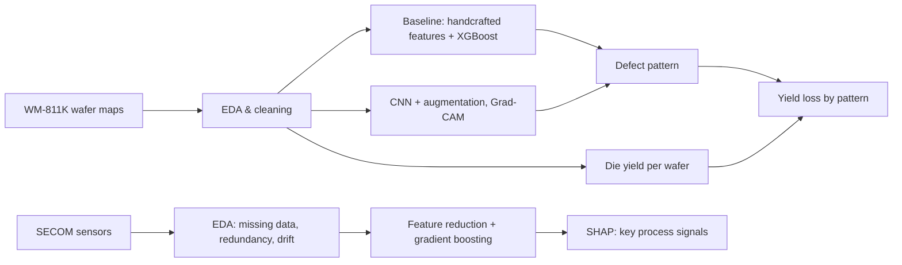
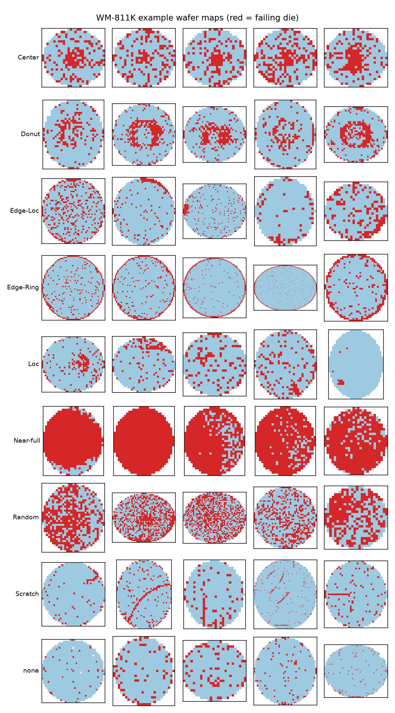
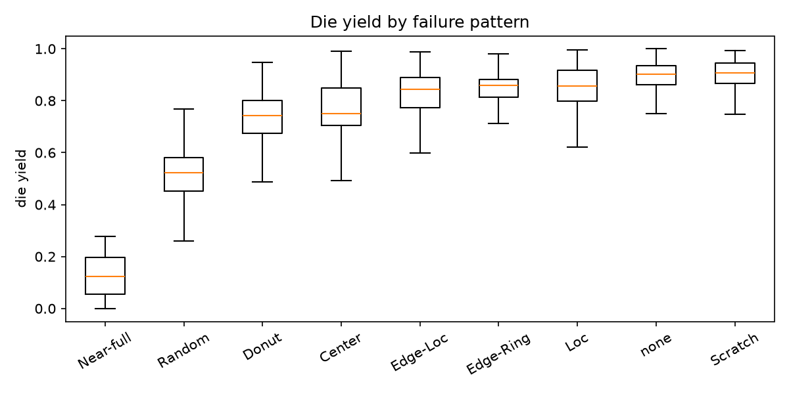
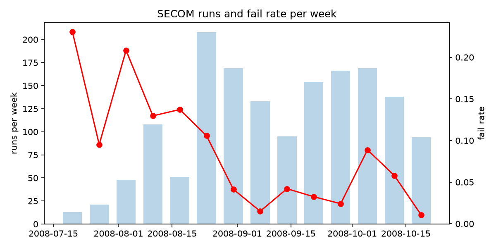
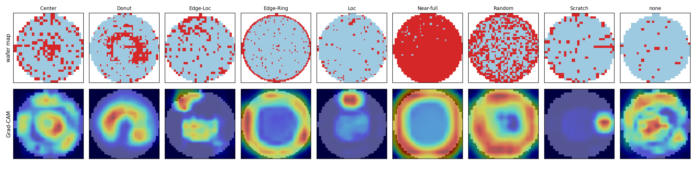
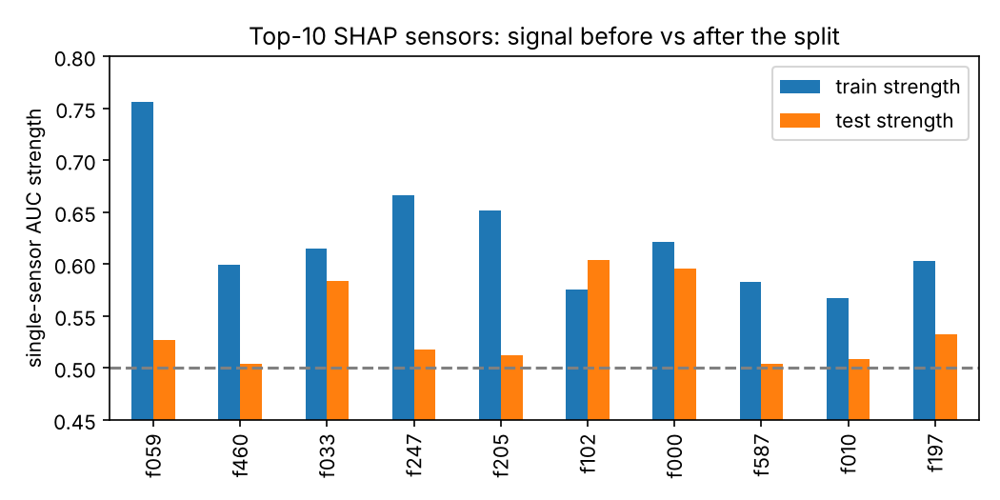
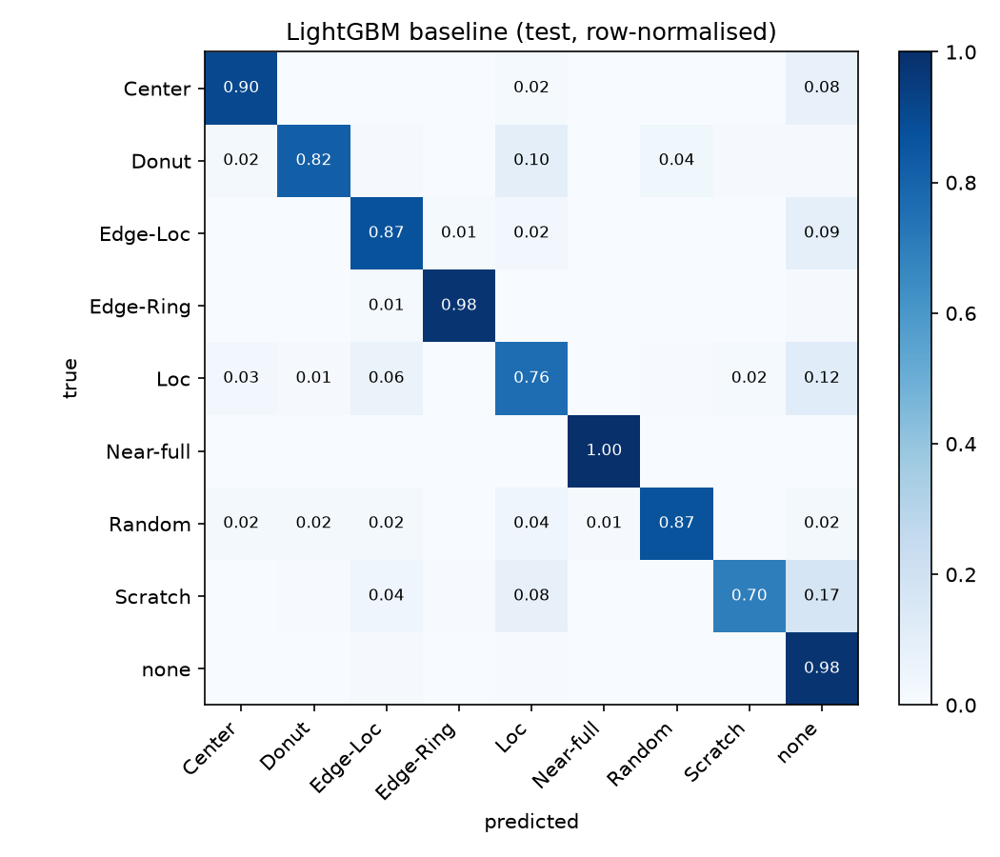
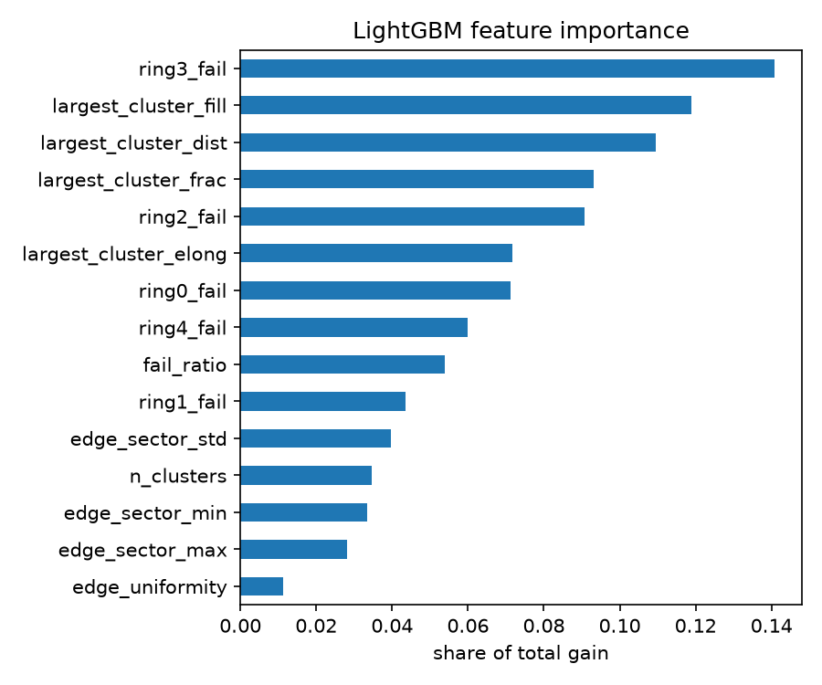

# Wafer Defect Classification & Yield Prediction


> **中文摘要：** 以公開半導體資料建立兩個模型：(1) 晶圓圖缺陷型態分類（WM-811K，CNN），
> (2) 由製程感測參數預測良品/不良（SECOM，梯度提升 + SHAP），並分析不同缺陷型態造成的良率損失。
> 重點放在不平衡資料處理、可解釋性，以及對製程工程師有用的結論。

## Why this project

In semiconductor manufacturing, every point of yield is money. Engineers need to know
**what kind of defect** is on a wafer (its spatial pattern points to the root-cause tool or
step) and **which process conditions** lead to failures. This project tackles both questions
with public fab data and asks how much yield each defect pattern costs.

## Datasets

| Dataset | What it contains | Task here |
|---|---|---|
| [WM-811K](https://www.kaggle.com/datasets/qingyi/wm811k-wafer-map) | 811,457 wafer maps (die pass/fail grid), ~172k labeled with 9 patterns | Classify defect pattern; compute per-wafer die yield |
| [SECOM](https://archive.ics.uci.edu/dataset/179/secom) | 1,567 production runs × 590 anonymised sensor readings, pass/fail label | Predict fail; find the process signals that drive it |

**Honest limitation:** the two datasets come from different fabs and share no wafer IDs, so
one wafer cannot be traced from its process readings to its defect pattern. The
"defect → yield" link is built *within* WM-811K, where each map records which dies failed.

## Pipeline



## Roadmap

- [x] **Step 1 — Data exploration & problem framing**: loaders, cleaning, EDA notebooks, tests, CI
- [x] **Step 2 — Defect pattern classification** (WM-811K): baseline → CNN, imbalance handling, Grad-CAM
- [x] **Step 3 — Process-based fail prediction** (SECOM): leakage-free pipeline, time split, LightGBM, SHAP, drift analysis
- [ ] **Step 4 — Defect → yield analysis & demo**: yield loss per pattern, Streamlit app

## Key findings so far (step 1: EDA)

**Defect pattern drives yield loss, but unevenly.** Mean die yield by pattern on the 172,950
labeled WM-811K wafers:

| Pattern | Near-full | Random | Donut | Center | Edge-Loc | Edge-Ring | Loc | Scratch | none |
|---|---|---|---|---|---|---|---|---|---|
| Mean die yield | 12% | 52% | 72% | 77% | 82% | 85% | 85% | 90% | 89% |

`Near-full` and `Random` wafers are effectively scrap, while `Scratch` costs almost nothing in die
count. Catching high-impact patterns early matters more than treating all classes equally.




**Both datasets are heavily imbalanced.** The rarest wafer class (`Near-full`, 149 wafers) is
~990x smaller than `none`; only 6.6% of SECOM runs fail. → Metrics are macro-F1 and PR-AUC.

**SECOM is noisy and redundant.** 116 of 590 sensors are constant, 28 are mostly empty, and 329
sensor pairs correlate above 0.95.

**SECOM's fail rate drifts over time**, from ~10–23% per week in July–August to mostly 1–6% from
September. A random split would overstate performance, so step 3 uses a time-ordered split.



**WM-811K's original train/test split has very different class mixes** in each half, so step 2
re-splits labeled wafers by class, grouped by lot to avoid leakage.

Full write-ups: [WM-811K findings](reports/findings_01_wm811k.md) ·
[SECOM findings](reports/findings_02_secom.md)

## Results

_Model results are filled in as each step is completed._

| Task | Model | Macro-F1 | Yield-loss capture* | Accuracy |
|---|---|---|---|---|
| Defect pattern (9 classes) | LightGBM, 15 handcrafted features | **0.861** | 0.921 | 0.967 |
| Defect pattern (9 classes) | CNN, 64x64 maps | **0.868** | 0.921 | 0.973 |

\* *Yield-loss capture*: share of failing dies on patterned wafers whose pattern was identified
correctly. Macro-F1 treats a missed `Scratch` (a few dies) like a missed `Near-full` (a scrapped
wafer); this metric weights mistakes by the dies they represent.

Test set: 34,585 wafers (20%), **split by lot** so no lot appears in both training and test.
Predicting `none` for every wafer would already score 0.852 accuracy, which is why accuracy is
not the headline.

The baseline's weak spots are `Scratch` (recall 0.70) and `Loc` (0.76): small, local patterns that
are mostly *missed* (called `none`) rather than confused with another pattern.
[Full baseline write-up](reports/findings_03_baseline.md)

**The CNN fixes the baseline's weakest class but not all of them.** `Scratch` recall rose from
0.70 to 0.83 (a thin line is easy for convolutions, hard for ring averages), while `Loc` fell from
0.76 to 0.68 (position matters there, and the handcrafted features encode it more directly). The
overall gain (+0.007 macro-F1) comes from one training run, so the fair summary is that the two
models are on par overall and complementary, which points to an ensemble next.
Grad-CAM confirms the CNN looks at the defect itself: the edge for `Edge-Ring`, the line for
`Scratch`, the blob for `Loc`. [Full CNN write-up](reports/findings_04_cnn.md)



### Process fail prediction (SECOM)

Trained on the earliest 70% of runs, tested on the latest 30% (471 runs, 26 failures).
Brackets are bootstrap 95% intervals.

| Model | Random-CV PR-AUC | **Time-split PR-AUC** | Time-split ROC-AUC | Recall @ 5% false alarms |
|---|---|---|---|---|
| Logistic regression (L1) | 0.192 | 0.082 [0.044, 0.172] | 0.539 | 0.15 |
| LightGBM | 0.196 | 0.086 [0.054, 0.143] | 0.662 | 0.04 |
| *Random model (= fail rate)* | *0.066* | *0.055* | *0.500* | *0.05* |

**The headline is a negative result, and why.** Shuffled cross-validation, used in many SECOM
write-ups, suggests the model is ~3x better than chance. On a later time period it is barely
better than chance. Two checks explain the gap:

- **The sensors shift:** a classifier separates training-period from test-period runs with
  **AUC 0.996** (adversarial validation).
- **The sensor–failure link changes:** `f059`, the most important sensor in training (single-sensor
  AUC 0.76), has no signal afterwards (0.47); 7 of the top 10 sensors lose most of their signal.

So a model trained once should not run as a fail alarm. It still gives engineers a useful
shortlist: sensors that predicted failures *both* before and after the shift (`f033`, `f102`,
`f000`), and sensors that drifted most (`f116`, `f542`, `f058`). Deployment would need drift
monitoring and regular retraining. [Full SECOM write-up](reports/findings_05_secom_model.md)






**Why these metrics:** both datasets are heavily imbalanced (most wafers are `none`; ~7% of
SECOM runs fail), so accuracy would reward a model that always predicts the majority class.

## Repository structure

```
├── data/                 # raw/ and processed/ (git-ignored; see "Quick start")
├── notebooks/            # 01-02 EDA, 03 feature baseline, 04 CNN (Colab), 05 SECOM model
├── reports/figures/      # charts used in this README
├── scripts/
│   ├── download_data.py  # fetches both datasets
│   ├── prepare_wm811k.py # 64x64 maps + lot-grouped split -> compact .npz
│   └── make_notebooks.py # notebooks are generated from source for clean diffs
├── src/wafer/            # data, eda, preprocess, features, evaluate, cnn, secom
├── tests/                # pytest on synthetic data, runs in CI without downloads
└── app/                  # Streamlit demo (step 4)
```

## Quick start

```bash
git clone https://github.com/join8112/wafer-yield-portfolio.git
cd wafer-yield-portfolio
python -m venv .venv && source .venv/bin/activate   # Windows: .venv\Scripts\activate
pip install -r requirements.txt && pip install -e .

# SECOM downloads directly. WM-811K needs a Kaggle token in ~/.kaggle/kaggle.json
python scripts/download_data.py

jupyter lab notebooks/          # 01, 02: exploratory analysis
python scripts/prepare_wm811k.py  # builds data/processed/wm811k_labeled_64.npz
                                  # 03: feature baseline (CPU, a few minutes)
                                  # 05: SECOM model (CPU, under a minute)
pytest
```

**CNN (notebook 04) on Colab:** open
[`04_cnn_colab.ipynb` in Colab](https://colab.research.google.com/github/join8112/wafer-yield-portfolio/blob/main/notebooks/04_cnn_colab.ipynb),
switch the runtime to a T4 GPU and run all cells. Colab machines are wiped after each session,
so put `wm811k_labeled_64.npz` (~40 MB) in Google Drive at `MyDrive/wafer/` (or set
`USE_DRIVE = False` to upload it directly). Results are saved to Drive and downloaded as a zip.

> `pandas` is pinned below 3.0 because `LSWMD.pkl` was saved with a very old pandas version
> that pandas 3 can no longer read.

CNN training (step 2) is designed to run on **Google Colab's free GPU**; everything else runs
on a laptop CPU.

## Skills demonstrated

- **Imbalanced classification**: metric choice, class weighting, augmentation
- **Computer vision**: CNN on wafer-map images, Grad-CAM interpretability
- **High-dimensional tabular ML**: leakage-free preprocessing pipeline, L1 selection, gradient boosting, SHAP
- **Honest evaluation**: time-ordered and lot-grouped splits, bootstrap intervals, adversarial validation for drift
- **Domain reasoning**: connecting defect patterns and process signals to yield
- **Engineering**: installable package, tests on synthetic data, CI, reproducible setup

## License

MIT
